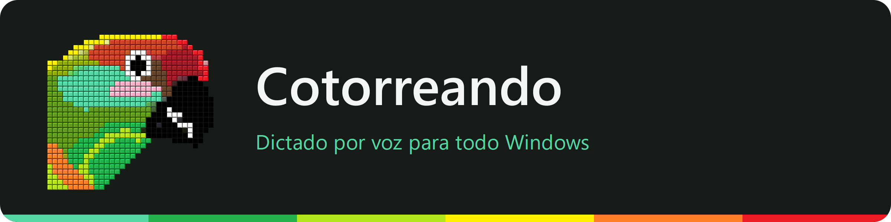

<p align="center">
  
</p>

<p align="center">
  <a href="LICENSE"></a>
  
  
  <a href="https://github.com/alfiq/cotorreando/releases"></a>
</p>

# Cotorreando

Dictado por voz para todo Windows. Hablas, y el texto aparece donde esté el cursor:
en el navegador, en el editor, en el chat… El reconocimiento corre en tu máquina: sin nube, sin
cuentas y sin telemetría. Solo se conecta para descargar los modelos y, una vez al día, para ver si
hay versión nueva. Detalles en [Privacidad](docs/PRIVACIDAD.md) ([English](docs/PRIVACY.md)).

Usa [NVIDIA Parakeet TDT 0.6B v3](https://huggingface.co/nvidia/parakeet-tdt-0.6b-v3)
(25 idiomas europeos, con puntuación y mayúsculas) sobre ONNX Runtime.

## El blob

Un círculo flotante, siempre encima de todo, que muestra lo que está pasando:

| Estado | Aspecto |
|---|---|
| Desactivado | Gris y quieto. No consume CPU en animación. |
| Escuchando | Verde cotorra, respira suavemente. |
| Hablando | Se deforma con tu voz y suelta ondas a su alrededor. |
| Escribiendo | Recorre los colores del plumaje: menta, verde, lima, amarillo, naranja y rojo. |

Hablar y escribir se combinan: el texto aparece mientras hablas (≈0,8 s de retraso con GPU,
≈1,1 s solo con CPU), sin
borrar ni reescribir, y sin límite de duración. El tamaño se elige en Opciones.

- **Arrástralo** a donde quieras; lo sigue con un resorte elástico y recuerda la posición.
- **Clic derecho**: activar/desactivar, ocultar, opciones, entrenar mi voz, acerca de, salir.
- **Bandeja del sistema**: clic izquierdo lo muestra u oculta; clic derecho da el mismo menú.

## Modos de escucha

| Modo | Cómo funciona |
|---|---|
| Micrófono abierto | Escucha siempre; cada frase (separada por pausas) se escribe. |
| Pulsar para hablar | Mantén el atajo (por defecto `Ctrl+Win`) mientras hablas. |
| Activación por voz | Solo reacciona a voz por encima del umbral de energía. |
| Activación por palabra clave | Di «oye cotorro …»; sigue escuchando unos segundos después. |

En los modos que no son *pulsar para hablar*, el atajo activa o desactiva.

**Si tecleas, el dictado se pausa** aunque sigas hablando, y se reanuda tras el
tiempo de amortiguamiento configurable (1,2 s por defecto).

El umbral puede fijarse a mano o dejar que la app lo calcule: mide el ruido de fondo
mientras no hablas y lo pone 12 dB por encima.

El audio pasa por el procesador de WebRTC: supresión de ruido, cancelación de eco
(usando lo que suena por tus bocinas como referencia) y control automático de ganancia.

## Instalar y ejecutar

Requiere Windows 10/11 y Python 3.10 o superior.

```bash
pip install -e .
```

```bash
cotorreando
```

La primera vez descarga el modelo (~670 MB) a `%LOCALAPPDATA%\Cotorreando\models`, en una ventana
con el progreso (el loro se va encendiendo) y un botón para cancelar. Antes comprueba que haya espacio
libre; cada archivo se baja a `.part` y solo se da por bueno si su tamaño y su SHA-256 (los publica
Hugging Face) coinciden. Si no hay conexión, se corta o el modelo no carga, Cotorreando lo dice y ofrece
reintentar (la descarga se reanuda), volver a descargar, usar tu propio modelo o salir.

#### Usar tu propio modelo

En **Opciones → Modelo → Elegir carpeta…** (o desde el aviso de error) puedes apuntar a una carpeta con
otro modelo. Sirve un modelo NVIDIA NeMo **FastConformer-TDT** (p. ej. Parakeet TDT 0.6B v2/v3) exportado
a ONNX con la estructura de [onnx-asr](https://github.com/istupakov/onnx-asr):

| Archivo | Contenido |
|---|---|
| `nemo128.onnx` | preprocesador: entradas `waveforms`, `waveforms_lens` → espectrograma de 128 bandas mel |
| `encoder-model.onnx` o `encoder-model.int8.onnx` | entradas `audio_signal`, `length`; 2 salidas (submuestreo ×8, 80 ms por trama) |
| `decoder_joint-model.onnx` o `.int8.onnx` | entradas `encoder_outputs`, `targets`, `target_length`, `input_states_1`, `input_states_2`; 4 salidas; la primera trae los tokens, el blank y las duraciones TDT |
| `vocab.txt` | una línea `token índice` por token, `▁` marca el inicio de palabra, el índice más alto es el blank |
| `tokenizer.json` (opcional) | tokenizador de Hugging Face, para potenciar tus palabras |

Audio a 16 kHz. Da igual si está cuantizado a int8 o en float32 (si hay ambos se usa el int8). No sirven
modelos RNN-T o CTC (el decodificador no predice duraciones), Whisper u otras arquitecturas, ni un `.nemo`
sin exportar. Antes de aceptar la carpeta se abren los tres grafos en ONNX Runtime y se comprueban sus
entradas y salidas. Con un modelo propio no se usan las adaptaciones LoRA, que están entrenadas sobre el
modelo estándar.

### Ejecutable

```bash
powershell -ExecutionPolicy Bypass -File build.ps1
```

Genera `dist\cotorreando.dist\Cotorreando.exe` con Nuitka y el instalador
`dist\Cotorreando-<versión>-setup.exe` con [Inno Setup](https://jrsoftware.org/isinfo.php)
(`winget install JRSoftware.InnoSetup`). El instalador no pide permisos de administrador.

### GPU

Usa `onnxruntime-directml`, que funciona en CPU y aprovecha cualquier GPU de DirectX 12
si está activado «Usar GPU» en Opciones.

## Entrenar tu voz (LoRA)

Desde el menú, **Entrenar mi voz…**: lees en voz alta una lista de frases y se entrena
un adaptador LoRA para el modelo. Hay tres conjuntos en español (30, 60 y 150 frases),
y puedes añadir los tuyos como `.txt` en `%LOCALAPPDATA%\Cotorreando\datasets`.

Entrenar necesita PyTorch y NeMo (~6 GB). **No vienen incluidos**: la app avisa y los
instala aparte, solo si lo pides. Detalles en [docs/LORA.md](docs/LORA.md).

## Documentación

- [docs/DISENO.md](docs/DISENO.md) — arquitectura y decisiones.
- [docs/LORA.md](docs/LORA.md) — entrenamiento del adaptador.
- [docs/DECISIONES.md](docs/DECISIONES.md) — preguntas resueltas durante el diseño.
- [docs/IDEAS.md](docs/IDEAS.md) — ideas y pendientes.
- [docs/VERSIONES.md](docs/VERSIONES.md) — numeración de versiones y cómo publicar una.
- [THIRD_PARTY_NOTICES.md](THIRD_PARTY_NOTICES.md) — licencias y créditos.
- [CONTRIBUTING.md](CONTRIBUTING.md) — cómo reportar fallos, proponer ideas y contribuir código.

## Créditos

Autor: **Alfiq** · [github.com/alfiq](https://github.com/alfiq) ·
[github.com/alfiq/cotorreando](https://github.com/alfiq/cotorreando)

Inspirado en la idea de [Handy](https://github.com/cjpais/handy) (MIT).
Modelo [Parakeet TDT 0.6B v3](https://huggingface.co/nvidia/parakeet-tdt-0.6b-v3) de NVIDIA bajo
[CC BY 4.0](https://creativecommons.org/licenses/by/4.0/), convertido a ONNX y cuantizado a int8
por Ilya Stupakov.
El resto de componentes y sus licencias están en [THIRD_PARTY_NOTICES.md](THIRD_PARTY_NOTICES.md).

El código de Cotorreando tiene licencia MIT.

## Aviso de Windows al instalar

Cotorreando no tiene un certificado de firma emitido por una autoridad reconocida, así que Windows
SmartScreen puede mostrar «Windows protegió su PC». Para continuar, pulsa **Más información** y luego
**Ejecutar de todos modos**.

El ejecutable y el instalador van firmados con un certificado autofirmado (`CN=Alfiq`). Windows no lo
reconoce como editor de confianza, así que no evita el aviso. No hace falta instalar ningún certificado,
y no conviene importarlo en «Entidades de certificación raíz de confianza»: cualquier programa firmado
con esa clave pasaría a ser de confianza en tu PC sin ningún aviso.
