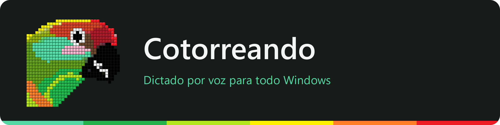
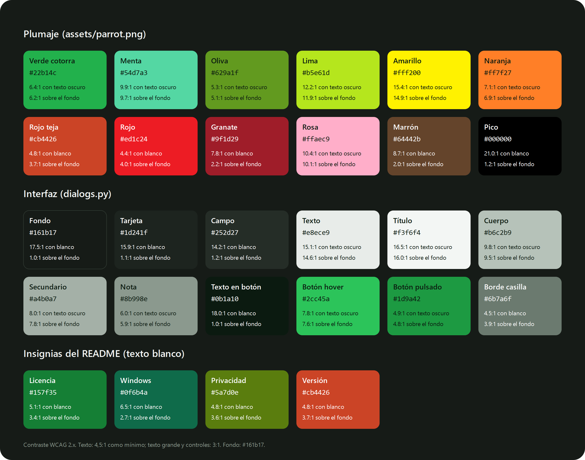

# Identidad visual

Guía de la identidad gráfica de Cotorreando: de dónde sale, qué colores usa, dónde viven en el
código y cómo regenerar las piezas derivadas. Vale para quien programe, para agentes de IA y para
quien quiera hacer material sobre el proyecto. Cualquier cambio de color o de aspecto debe seguirla
o, si la cambia, actualizarla en el mismo commit.

## Origen y personalidad

Todo parte de una cotorra dibujada a mano en 32×32 píxeles, `cotorreando/assets/parrot.png`. Su
plumaje da la paleta entera: verdes, menta, lima, amarillo, naranja y rojos. La cotorra "cotorrea":
habla mucho, y de ahí el nombre.

El tono es sobrio y cercano: una herramienta que hace su trabajo sin ruido. La interfaz es oscura,
con neutros ligeramente verdosos, y el color del plumaje aparece solo donde aporta significado
(acción principal, enlaces, estados).

## El logo



- **Fuente**: `cotorreando/assets/parrot.png`, 32×32, fondo blanco y pico negro.
- **Azulejado**: `cotorreando/mosaic.py` dibuja cada píxel como un azulejo con relieve (claro arriba
  y a la izquierda, sombra abajo y a la derecha; `_tile`, línea 16), sin suavizado. El papel blanco
  conectado al borde se elimina (`_background`), así que el logo no tiene fondo.
- **Progreso**: `Mosaic.set_progress` coloca los azulejos uno a uno en un orden aleatorio fijo
  (semilla 32). Los que faltan se ven en un gris oscuro derivado de su luminosidad. Así el logo sirve
  de barra de progreso.
- `logo_pixmap(tile)` devuelve el logo como imagen; lo usan la barra lateral de Opciones y el banner.
- Decisión registrada en [DECISIONES.md](DECISIONES.md), fila "Logo".

No se debe redibujar con suavizado, añadirle fondo, recolorearlo ni deformar su proporción.

## Paleta



La imagen la genera `scripts/palette.py`. Todos los contrastes son WCAG 2.x, calculados.

### Plumaje

Colores de `parrot.png`. "Sobre el fondo" es el contraste frente a `#161b17`.

| Color | Hex | Papel | Texto encima | Sobre el fondo |
|---|---|---|---|---|
| Verde cotorra | `#22b14c` | Acento principal: botones, foco, selección, pestaña activa, bandeja | Oscuro `#0b1a10` 6,4:1 (blanco solo 2,8:1) | 6,2:1 |
| Menta | `#54d7a3` | Enlaces, lema del banner, paso actual de calibración | Oscuro 9,9:1 (blanco 1,8:1) | 9,7:1 |
| Oliva | `#629a1f` | Solo en el dibujo | Oscuro 5,3:1 | 5,1:1 |
| Lima | `#b5e61d` | Mensajes de ánimo (`#cheer`), final del medidor | Oscuro 12,2:1 | 11,9:1 |
| Amarillo | `#fff200` | Plumaje del blob | Oscuro 15,4:1 | 14,9:1 |
| Naranja | `#ff7f27` | Borde del campo que graba un atajo | Oscuro 7,1:1 | 6,9:1 (5,6:1 sobre `#252d27`) |
| Rojo teja | `#cb4426` | Botón cerrar en hover, insignia de versión | Blanco 4,8:1 | 3,7:1 |
| Rojo | `#ed1c24` | Plumaje del blob | Blanco 4,4:1 (no apto para texto normal) | 4,0:1 |
| Granate | `#9f1d29` | Botón cerrar pulsado | Blanco 7,8:1 | 2,2:1 |
| Rosa | `#ffaec9` | Solo en el dibujo | Oscuro 10,4:1 | 10,1:1 |
| Marrón | `#64442b` | Solo en el dibujo | Blanco 8,7:1 | 2,0:1 |
| Pico | `#000000` | Solo en el dibujo | Blanco 21:1 | 1,2:1 |

El dibujo tiene además un oliva claro `#8fab0b` (16 píxeles) y algunos tonos sueltos de transición;
no forman parte de la paleta.

### Interfaz

Definida en `STYLE` y `apply_theme()` de `cotorreando/dialogs.py`.

| Papel | Hex | Contraste |
|---|---|---|
| Fondo de ventanas | `#161b17` | — |
| Tarjetas, visor de texto | `#1d241f` | — |
| Campos, listas, pista del medidor | `#252d27` | — |
| Texto | `#e8ece9` | 14,6:1 sobre fondo; 13,3:1 sobre tarjeta; 11,9:1 sobre campo |
| Títulos, elemento seleccionado | `#f3f6f4` | 16,0:1 sobre fondo |
| Cuerpo (`#body`), botón secundario | `#b6c2b9` | 9,5:1 sobre fondo; 8,6:1 sobre tarjeta |
| Secundario (barra lateral, pestañas, cerrar) | `#a4b0a7` | 7,8:1 sobre fondo; 5,7:1 sobre `#2a342d` |
| Notas, pies, título de ventana | `#8b998e` | 5,9:1 sobre fondo; 5,3:1 sobre tarjeta |
| Texto en botón principal | `#0b1a10` | 6,4:1 sobre `#22b14c` |
| Botón hover | `#2cc45a` | 7,8:1 con `#0b1a10` |
| Botón pulsado | `#1d9a42` | 4,9:1 con `#0b1a10` |
| Botón desactivado | `#333d36`, texto `#7b887e` | 3,0:1 (controles inactivos, exentos en WCAG) |
| Campo desactivado | `#1f2621`, texto `#6d7b71` | 3,5:1 (inactivo) |
| Borde de casilla sin marcar | `#6b7a6f` | 3,1:1 sobre campo; 3,9:1 sobre fondo |
| Atajo grabando: texto | `#ffb27a` | 8,0:1 sobre campo |
| Selección de menú y lista | `#2a342d` | — |
| Bordes y separadores | `#262e28`, `#29322b`, `#303a32`, `#333d36`, `#38433b` | decorativos |
| Pantalla de calibración | `#0d110e` | `#f3f6f4` 17,5:1; `#54d7a3` 10,5:1; `#8b998e` 6,4:1 |

## Reglas de la interfaz

- **Contraste**: texto 4,5:1 como mínimo (AA); texto grande (18 pt, o 14 pt en negrita) y controles
  o bordes que identifican un control, 3:1.
- **Nunca texto blanco sobre el verde cotorra ni sobre la menta**: 2,8:1 y 1,8:1. Sobre los colores
  claros del plumaje el texto va en `#0b1a10`.
- **Fondos**: tres niveles, de más oscuro a más claro: ventana `#161b17`, tarjeta `#1d241f`, campo
  `#252d27`. Los neutros llevan un ligero tinte verde; no usar grises puros ni azulados.
- **Acento**: el verde cotorra marca la acción principal, el foco o la selección. Las acciones
  secundarias son botones `#ghost` (transparentes con borde).
- **Estados**: hover aclara (`#2cc45a`), pulsado oscurece (`#1d9a42`), desactivado pasa a neutros.
  Grabando un atajo: naranja. Cerrar: rojo teja, y granate al pulsar.
- **Enlaces**: menta. Se fija en el CSS (`a`) y también en la `QPalette` (`Link`, `LinkVisited`),
  porque las etiquetas con texto enriquecido ignoran el CSS.
- **Medidor de nivel**: degradado de verde cotorra a lima.
- **Iconos auxiliares**: `assets/check.png` (marca oscura `#0b1a10`, sobre la casilla verde) y
  `assets/chevron.png` (gris `#9aa89d`, flecha de los desplegables).

## El blob y la bandeja

- `cotorreando/blob.py`, `PLUMAGE` (línea 34): menta, verde, lima, amarillo, naranja y rojo, en el
  orden en que corren por el plumaje. `plumage(place)` mezcla entre vecinos y va y vuelve sin saltos;
  al escribir, el blob recorre esa secuencia.
- Relleno base del orbe: verde cotorra profundo `QColor(16, 92, 62, 170)` (línea 278), con nubes de
  plumaje dentro y un brillo blanco translúcido.
- Desactivado: gris `QColor(128, 128, 134)` (`GREY`, línea 37). El anillo de carga usa ese gris al
  35 % como pista y `plumage(t)` como trazo.
- Bandeja (`cotorreando/app.py`, `_tray_icon`): círculo `#22b14c` (34, 177, 76) activo y el mismo
  gris desactivado.

## README, banner e insignias

- **Banner**: `docs/assets/banner.png`, generado por `scripts/banner.py`: tarjeta `#161b17` con
  esquinas redondeadas, logo azulejado, nombre en `#f3f6f4` (Segoe UI Semibold), lema en menta y una
  franja inferior con los colores de `PLUMAGE`.
- **Insignias de shields.io**: shields siempre pone el texto en blanco, así que usan variantes
  oscuras.

| Insignia | Hex | Blanco encima |
|---|---|---|
| Licencia | `#157f35` | 5,1:1 |
| Windows | `#0f6b4a` | 6,5:1 |
| Privacidad | `#5a7d0e` | 4,8:1 |
| Versión | `#cb4426` | 4,8:1 |

Una insignia nueva debe usar uno de estos colores u otra variante oscura del plumaje con 4,5:1 frente
al blanco.

## Instalador

`scripts/installer_art.py` dibuja el fondo del instalador (lo ejecuta `build.ps1`) con las plumas
del blob (`_feather`) sobre `#16171b`; `installer.iss` usa ese mismo color (`WINDOW_BACK`,
línea 103). Todavía no sigue la paleta: ver "Pendientes conocidos".

## Tipografía

Segoe UI, la fuente del sistema de Windows, en toda la interfaz (`dialogs.py`, línea 41: 10 pt) y en
el material generado. Pesos: normal para texto, 600 (Semibold) para títulos, botones y grupos.
Tamaños de referencia: título de página 16 pt, título de diálogo 18 pt, cuerpo 11 pt, notas 9 pt. En
las imágenes, los valores hex van en Consolas.

## Voz y tono del texto

- Español primero, con traducción al inglés en `cotorreando/i18n.py`. La documentación va en español.
- Frases cortas y concretas, tuteando: "Revisa Configuración > Privacidad > Micrófono",
  "Conéctate y vuelve a intentarlo".
- Los errores dicen qué pasó y qué hacer, sin culpar ni dramatizar.
- Puntos suspensivos tipográficos (…) en las entradas de menú que abren algo y en procesos en curso.
- **Sin emojis**, ni en la interfaz, ni en la documentación, ni en los commits.
- Tono profesional y sobrio; la simpatía la pone la cotorra, no hacen falta bromas en el texto.

## Hacer y no hacer

Hacer:

- Sacar cualquier color nuevo de esta guía, o justificarlo y añadirlo aquí.
- Comprobar el contraste antes de fijar un par texto/fondo.
- Regenerar las imágenes derivadas cuando cambie el logo o la paleta.

No hacer:

- Texto blanco sobre verde cotorra o menta.
- Grises puros o azulados en la interfaz, o colores ajenos al plumaje.
- Suavizar, recolorear o poner fondo al logo.
- Usar el rojo `#ed1c24` para texto normal.
- Emojis.

## Dónde vive cada color

| Archivo | Qué define |
|---|---|
| `cotorreando/assets/parrot.png` | El dibujo original y la paleta |
| `cotorreando/mosaic.py` | Logo azulejado y progreso |
| `cotorreando/dialogs.py` (`STYLE`, líneas 40-106; `apply_theme`, línea 109) | Toda la interfaz |
| `cotorreando/assets/check.png`, `chevron.png` | Iconos de casilla y desplegable |
| `cotorreando/blob.py` (`PLUMAGE`, `GREY`, `_paint_orb`, `plumage`) | El blob |
| `cotorreando/app.py` (`_tray_icon`) | Icono de bandeja |
| `cotorreando/lora/screen.py` (línea 77), `cotorreando/lora/ui.py` (línea 231) | Pantalla de calibración |
| `scripts/banner.py` | Banner del README |
| `scripts/palette.py` | Imagen de la paleta |
| `README.md` (líneas 6-9) | Insignias |
| `scripts/installer_art.py`, `installer.iss` | Instalador |
| `cotorreando/icon.ico`, `cotorreando/icon.png` | Icono de la aplicación |

## Regenerar las piezas derivadas

```bash
python scripts/banner.py                       # docs/assets/banner.png
python scripts/palette.py                      # docs/assets/paleta.png
python scripts/installer_art.py <salida.bmp>   # lo hace build.ps1 al empaquetar
```

`palette.py` tiene su propia lista de colores: si cambia la paleta, hay que actualizarla también allí.

## Pendientes conocidos

- **Icono de la aplicación**: `cotorreando/icon.ico` e `icon.png` siguen siendo el orbe antiguo azul
  y magenta, fuera de la paleta. Según DECISIONES.md queda como mascota, pero no casa con el resto de
  la identidad.
- **Instalador**: `scripts/installer_art.py` pinta las plumas con tonos HSV 320, 200, 140, 265 y 45
  (magenta, azul, verde, violeta y ámbar), no con `PLUMAGE`. Además su fondo, `#16171b`, es un
  neutro azulado: el comentario de `installer.iss` dice que es el color de las ventanas, pero la app
  usa `#161b17`, de tinte verde.
- **Paleta duplicada**: los colores están escritos a mano en cada archivo; no hay un módulo único de
  colores.
